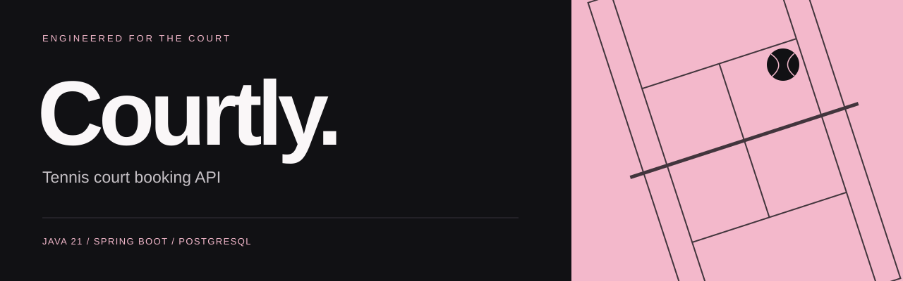
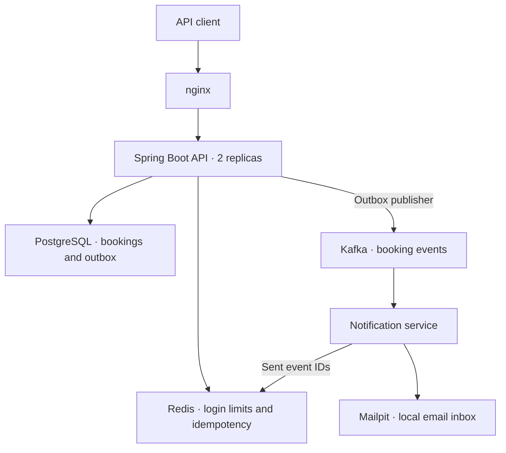

<p></p>

<p>
  <a href="https://github.com/stefankabasaj/Courtly/actions/workflows/ci.yml"></a>
  &nbsp; 
  
  
</p>

### Tennis court booking, from reservation to confirmation.

A backend for managing tennis courts, bookings and payment records. Built around the details that make a reservation system work: access control, payment retries, unpaid booking expiry and booking notifications.

**Java 21 · Spring Boot 3.5 · PostgreSQL 16 · Redis · Kafka · Docker**

[Application docs](./Courtly/README.md) &nbsp; / &nbsp; [Design decisions](./Courtly/docs/decisions.md) &nbsp; / &nbsp; [Local setup](./Courtly/docs/local-setup.md) &nbsp; / &nbsp; [Postman collection](./Courtly/Courtly-API.postman_collection.json)

---

## The product

Players register, browse courts, check availability and reserve a slot. Administrators manage courts and bookings. Booking events drive email notifications through a separate service.

Payments use a **simulated gateway** for development. Unpaid bookings expire automatically to release the slot.

## Engineering focus

| Concern | Implementation |
| :--- | :--- |
| Authentication & access | Spring Security, JWT and user/admin roles |
| Payment retries | Idempotency keys return the original result for repeated requests |
| Booking events | Kafka and a transactional outbox |
| Notifications | A separate service sends emails from booking events |
| Login protection | Redis-backed rate limits shared between instances |
| Data changes | PostgreSQL and versioned Flyway migrations |
| Observability | Prometheus metrics, Grafana dashboard, alert rules and request IDs in logs |
| API documentation | Generated OpenAPI specification and Swagger UI |

## Architecture

The local stack runs two API replicas behind nginx. PostgreSQL stores bookings and their outbox events; a publisher forwards committed events to Kafka. The notification service consumes those events and sends booking emails.



Prometheus scrapes the API and notification service. Grafana ships with a provisioned dashboard; request IDs connect HTTP requests with booking events and email logs.

## Decisions worth reading

- **Double-booking protection.** A PostgreSQL exclusion constraint rejects overlapping reservations, including requests that race across API replicas. [Migration](./Courtly/src/main/resources/db/migration/V2__fix_admin_password_and_overlap_constraint.sql)
- **Reliable booking events.** The booking change and outbox entry share a database transaction. Publishing is at least once; the notification service uses Redis to track sent event IDs. [Outbox publisher](./Courtly/src/main/java/com/stefankabasaj/courtly/event/OutboxPublisher.java)
- **Payment retries.** Redis claims each idempotency key before processing and caches the completed response. The design notes describe the remaining crash window. [Idempotency service](./Courtly/src/main/java/com/stefankabasaj/courtly/idempotency/IdempotencyService.java)

See the [design notes](./Courtly/docs/decisions.md) for the tradeoffs, failure cases and implementation details.

## Run locally

From the repository root:

```bash
cd Courtly
cp .env.example .env
docker compose up --build
```

Before starting, configure your local environment file, including `JWT_SECRET`, `ADMIN_EMAIL` and an `ADMIN_PASSWORD` of at least 12 characters. See the [setup guide](./Courtly/docs/local-setup.md) for the full configuration.

| Service | Local URL |
| :--- | :--- |
| Health | http://localhost:8080/api/v1/health |
| Swagger UI | http://localhost:8080/swagger-ui.html |
| OpenAPI JSON | http://localhost:8080/v3/api-docs |
| Development email inbox | http://localhost:8025 |
| Prometheus | http://localhost:9090 |
| Grafana | http://localhost:3001 |

## Explore the code

| Path | Contents |
| :--- | :--- |
| [`Courtly/src/`](./Courtly/src/) | Application source and tests |
| [`Courtly/notification-service/`](./Courtly/notification-service/) | Event-driven booking emails |
| [`Courtly/docs/`](./Courtly/docs/) | Local setup and design decisions |
| [`Courtly/pom.xml`](./Courtly/pom.xml) | Maven dependencies and build configuration |
| [`Courtly/docker-compose.yml`](./Courtly/docker-compose.yml) | Local container setup |
| [`Courtly/CONTRIBUTING.md`](./Courtly/CONTRIBUTING.md) | Contribution guidelines |

## Verification

From the application directory, run the API tests and then the notification service tests:

```bash
./mvnw test
(cd notification-service && ./mvnw test)
```

PostgreSQL integration tests use Testcontainers and need Docker. For the full local stack, run:

```bash
./scripts/smoke-test.sh
```

The smoke test covers authentication, concurrent booking requests, payments and booking emails through nginx, PostgreSQL, Redis and Kafka. It creates a temporary Compose stack and removes its containers and volumes on exit. See the [script](./Courtly/scripts/smoke-test.sh) for prerequisites and required ports.

[GitHub Actions](https://github.com/stefankabasaj/Courtly/actions/workflows/ci.yml) runs both test suites, builds the API JAR and Docker image, and then runs the full-stack smoke test. The badge above reflects the workflow's current result.

## Project scope

Courtly is a backend portfolio project. Payments are simulated, emails go to Mailpit locally, and booking times follow one venue timezone. The repository contains the API and notification service; a customer-facing frontend and live payment integration are outside its current scope.


---

Built by [Stefan Kabasaj](https://github.com/stefankabasaj) · Former NCAA Division I tennis player  
[Portfolio ↗](https://stefankabasaj.me)
